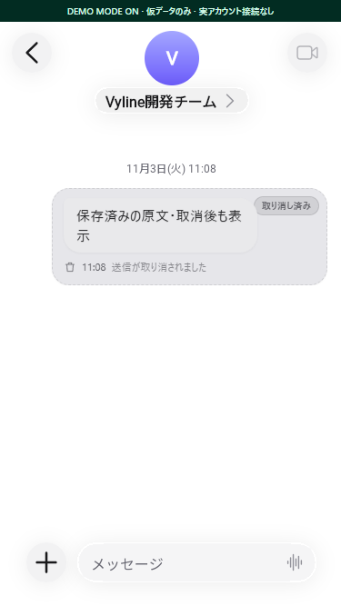
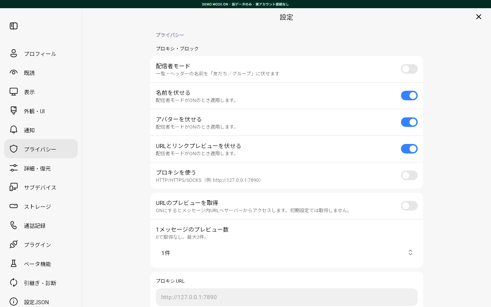

# 非通話機能の補完と検証（2026-11-03）

## 対象と保護境界

- 実装先: `tqmane/vyline`、基準 `d9abafc9e74893be3efcf82fbce409470563cd1a`。
- 比較元: `nezumi0627/vyline`、再取得時点 `f239927c2696c108d5cf87da134af32071ca7df5`（資料の `e16fc8b` から更新あり）。参照専用。
- 実行環境: Linux。変更は `Vyline/` 内、作業ブランチ `codex/noncall-feature-parity`、PR は `tqmane/vyline` 宛ての1本。
- 通話・録画・録音・通話イベント、既読者・初回既読時刻・既読範囲の処理は保護し、上流の方式に置換しない。
- 独自UI、Compose/Wasm、split pane、React bridge、ChatGPT連携、既存DB形式を維持する。
- 実アカウント操作や外部への診断自動送信は行わず、fixtureとローカルテストを使う。

## 実装・検証結果

| 順序 | 範囲 | 受け入れ条件 | 確認方法 | 状態 |
| --- | --- | --- | --- | --- |
| 1 | CHAT-09/07 | 保存済み原文と添付が相手の取消後も残り、明示削除は復活しない | DB・イベント・表示fixture、再オープン・バックアップ・ブラウザキャッシュ | fixture確認済み |
| 2 | CHAT-01 | DB検索、regex、未ロード履歴への移動、pane/account分離 | 日本語・絵文字・100件超・不正/遅延regex・中断・native controller | fixture確認済み |
| 3 | CHAT-02 / AUX-03 | opt-inで安全なURL取得、SSRF/過負荷/秘匿URLを拒否 | DNS固定・redirect・内部IP・本文/画像上限・秘密クエリ・悪意あるHTML | mock確認済み |
| 4 | SOC-01〜07 | 既存プロフィール/グループ/ノートを維持し不足操作を接続 | readonly MID→個別確認、group/room、画像拡大、ノート詳細、友だち区別、ブロック永続化 | mock/UI確認済み |
| 5 | SET-01〜04/06〜11 | サポート、診断確認、設定JSON、同意履歴と各設定が画面から利用可能 | 秘匿化・ZIP展開・復元・Storage失敗・通知・privacy・native設定 | fixture確認済み |
| 6 | SET-05 | 匿名/任意認証モード、メモリ限定セッション、期限・削除・account分離 | Cookie/履歴は明示送信、期限・削除・ログアウト時破棄、通信mock | mock/UI確認済み |
| 7 | CHAT-03〜08 | 既存DB・スクロール・表示・既読の回帰を確認 | 既存回帰suite、保護領域の機械比較 | 既存方式維持 |
| 8 | 統合 | 型・lint・build・UI確認、1本のPR | 下記実行結果と制限 | ローカル確認済み、Linux最終実行は未完了 |

Windows認証候補（SET-12）はLinuxのため適用外。任意のCLI/MCP（AUX-01）と新規カタログ（AUX-02）は追加せず、既存の連携・fixtureを使う。

## 証跡

`bun run vyl:doctor`: Bun 1.4.0、submodule、依存ディレクトリを検出。環境ファイル未作成のため終了1。テストのために実認証情報は作成しない。

ローカル検証環境は Windows / Bun 1.4.0 / Chrome。実アカウントへの送信・招待・友だち変更は実行していない。

- `bun test`: 1004 pass / 0 fail、192ファイル。SQLite等の隔離プロセス内の追加ケースは各suiteで別途実行される。
- `bun run typecheck`: protocol/backend/desktop/CLI/create-plugin/vylを確認。
- `bun run lint`: 全対象で成功。新規コードの抑制ルール追加なし。
- `bun run build`: Compose/Wasmの生成を含め成功。
- `bun tests/noncall-parity.browser.mjs`（desktopディレクトリ）: legacy/NezuUI/iMessage/Fluent/Miuix × 375×667 / 390×844 / 768×1024 / 1440×900の20ケース。取消後の原文・設定カテゴリの実表示、pageerror 0を確認。通信はlocalhost以外を遮断。
- `bun tests/social-profile.browser.mjs`: プロフィール・友だち操作・group/room・ノート・native確認/画像拡大の14チェック成功、pageerror 0。
- 検索用ブラウザfixture、URL preview hook、Agent Iのブラウザテストもmock接続で実行。
- 既存の通話・既読の51関数/分岐をTypeScript AST単位で基準コミットと比較し一致。通話専用ファイル、`readReceiptRanges.ts`、submoduleの差分なし。
- Linux / Bun 1.4.0でも型チェックとlintを実行したが、最終変更後の全体テストとbuild/runtimeの完走確認は行っていない。

## 取消保持の原因と修復

1. 受信/取消イベントをDB commit前に公開していた。原文保存→取消snapshot保存→通知へ順序を変更し、保存中のセッション交代後には公開しない。
2. `UNSENT`/`UNSEND`の履歴取得で通常行を上書きし、原文snapshot生成前に本文・添付情報を失っていた。placeholderと取消済み状態を統合時に識別し、後着した原文や古いsnapshotからも保存済みの原文を保持する。
3. Composeでは取消済みを一律に置換表示し、既存のReact原文rendererへ到達していなかった。相手取消の非通話メッセージを既存host rendererへ接続する。自分の取消は既存動作を維持する。
4. 明示削除にはaccount/chat/message単位のtombstoneを使う。相手の取消とは分離し、古い履歴・snapshot・選択バックアップ・表示キャッシュで復活させない。削除失敗時はUIの原文を残す。
5. 元データが一度も届いていないplaceholderに原文を生成しない。保存済みsnapshotのメディア型と復号情報を使い、取消を理由に既存メディアキャッシュを削除しない。

`lineService.revocations.test.ts`、`chatStore.sqlite.test.ts`、`messageRetention.test.ts`、`vyline-hydration.test.ts`に失敗fixtureから追加した回帰ケースがある。read op、readByAtの初回時刻保持、既読マージ・範囲、通常/通知なしの自己取消RPCは変更しない。

## 維持した実装と制限

- CHAT-04/05: `intentionally-different`。既存のaccount別SQLiteを正本とし、大規模履歴はページング・既存LRUウィンドウで読む。上流のDBモデルやIndexedDB永続化への置換は行わない。
- CHAT-06/08、SOC-04/08: `exists / intentionally-different`。既存スクロール、Flex/Rich/スタンプ、プロフィールfallbackを維持し、確認できた不足のノート詳細・画像拡大・検索連携だけを接続した。全既存形式の実端末比較は未実施。
- SET-10: `exists`。ToSは既存のブラウザ単位の同意を維持する。設定JSONからToSや認証状態を読み込まない。
- SET-12: `not-applicable`（Linux）。任意のWindows認証候補スキャン、AUX-01の追加CLI/MCP、AUX-02の新規カタログは追加しない。
- URL追加取得は既定OFF、件数0でも停止、配信者モード中は停止。外部画像は取得・検査したバイトをaccount別プロキシ経由で表示する。
- mediaAutoSaveはaccount別設定。OFFでも一時ファイルによる表示・明示ダウンロード・Rangeを維持する。異常終了時の一時ファイルは次回取得時に1時間以上経過したものだけ掃除する。
- サポートZIPと報告文プレビューはブラウザ内で生成する。専用のネットワークAPIは増やさない。画像は選択・再エンコード・確認後の手動添付。Issueを自動作成したりログを自動アップロードしたりしない。
- 実LINE/Yahoo通信、実アカウントでの再ログイン、物理端末、長時間の実メディア再生は未検証。コードとmockの存在を実サービス成功の保証とはしない。
- 日本語表示文は指定の `agy` / `gemini-3.8-flash-high` / highで5画面を確認し、変更不要との結果。新しい翻訳基盤や言語は追加していない。

## 実画面の例

すべて外部通信を遮断したデモfixture。実アカウント情報は含まない。

## SET-07・CIの追補

初回PRに残った名前・アバター・URLマスクの適用漏れを補完する。チェックボックスだけで完了とせず、各表示経路の実画面とコピー結果を確認した。

- 名前とアバターのマスクを独立させ、チャットヘッダー、送信者・リアクションの表示名、サイドバー、プロフィール、共通グループ、MIDコピー/編集フィールドへ反映。
- URLマスクを検索結果、ステータス、アナウンスの本文/title/aria-label、返信引用・入力欄の返信プレビュー、native payloadへ反映。検索結果はマスクしてから文字数を制限する。
- 既知のメンションはUTF-16範囲で表示・コピー用の名前を置換する。@ALL、検索条件、元本文、選択対象MID、送信データは保持する。
- 連絡先カード、位置情報の本文・地図リンク、ファイル名/download属性、通常/取消済みの返信引用にも適用。Flex/Richの文字・span・aria-label・fallbackとURI/clipboard actionを保護し、マスク対象の操作は実行しない。
- `tests/streamer-privacy.browser.mjs`: 5モード×全8組み合わせ＋コピー、45チェック成功。`tests/social-privacy.browser.mjs`: プロフィール等110チェック成功。いずれもpageerror 0、外部通信遮断。
- カードのSSR回帰30テストとFlex/Richの6テストでも、マスクの独立性・元データ不変・外部fetchなしを確認。
- 追加後のローカル全体テスト: 1047 pass / 0 fail、196ファイル。型チェック、lint、Compose/Wasmを含むbuildも成功。

CIのOSV失敗はnpm 17パッケージとGo 2パッケージの依存関係で発生した。検査の無効化・除外追加は行わず、必要なmanifestとlockを更新した。CI修復のため、既存PRの変更範囲にルートの`package.json`と`bun.lock`を含める。

- Hono、MCP SDK、Vite、Undici、Zod等を修正済みのパッチ/マイナーへ更新し、transitive依存も再解決。
- minimatchは[公式advisory](https://github.com/advisories/GHSA-g3hv-75wg-m249)の修正版11系へ更新し、既存Frida呼出しの`Minimatch`契約をテスト。
- 既存Go tunnelのOpenTelemetry SDKと`x/net`を修正版へ更新。Goソースやプロトコルは変更せず、`go mod verify`とLinux/amd64のクロスビルドを確認。
- CIと同じ3つのlockをOSV v2.5.0で検査し、検出0件。clean checkoutのfrozen install、PostCSS/Tailwind、ログ整形、Node側Undici、MCP/Agent I等の互換テストも確認。
- Linuxの最終ビルド・起動確認とOSVは[PR #77のGitHub Actions](https://github.com/tqmane/vyline/pull/77/checks)で追跡する。利用者のサーバーを検証環境には使わない。

この追補も、CHAT-04〜06/08・SOC-08の全ケース比較、実LINE/Yahoo通信、物理端末の完走を意味しない。任意項目とWindows専用項目は上記のとおり対象外。

## 2026-11-06 招待拒否・24時間取消・ミュート送信の追補

基準は `tqmane/vyline` の `e461841c83bc002e9655d3f7df68bd7687c62607` と、protocol submodule の `600fccde62273b83b173ac250dc72197ff6a1dfc`。

### 招待拒否の選択

友だち一覧にいない利用者も「MIDで追加」で対象にできる。入力は前後空白を除去し、小文字へ正規化した `u` + 32桁の16進数として検証する。重複と自分自身を除外し、保存された非友だちのMIDも再表示する。チェック済みを先頭へ並べ、名前とMIDの両方で検索できる。画面の状態はアカウント・チャットごとに分離する。

[PrtivateLEIN feat/26.2.0 の GroupInviteReject.java](https://github.com/tqmane/PrtivateLEIN/blob/bcb742d1f360c8eaf3208846bdbf0e03d5db704c/app/src/main/java/io/github/hiro/LEINs/hooks/GroupInviteReject.java) の履歴取得時の再走査と、招待中／参加済みの分岐を参照した。Vylineでも保存時と参加イベントに加え、通常のチャット履歴取得時に設定を再適用する。ローカル専用取得・過去ページ・差分取得では追加実行しない。

招待取消と参加が競合して処理に失敗したときは、参加状態を1回再取得して、参加済みの対象を退会へ切り替える。再取得でも失敗した場合は保存済み・適用失敗として警告する。成功した退会だけをメンバーキャッシュから除去して再取得対象にし、失敗した対象を画面上だけ削除しない。対象、設定の有効状態、操作中のクライアントを実行前に確認する。

### 取消の時間と失敗時の処理

通常の送信取消は送信時刻から24時間以内（境界を含む）まで、画面とBFFで同じ判定を使用する。プレミアムの7日と通知なし取消の既存条件は維持する。時刻不明・未来・取消済みのメッセージを誤って許可しない。サーバーが取消を拒否した場合はエラーを返し、成功した扱いで保存せず、画面の仮表示も元へ戻す。

### ミュート指定とバージョンヘッダー

テキスト、スタンプ、組み合わせスタンプ、LINE絵文字、画像・動画・音声・ファイルで、送信開始時のミュート指定を固定する。既存の「常にミュート送信」を既定値とし、その送信で明示した `false` を優先する。再送可能な種類は、設定変更後でも初回の指定を保持する。

`NOTIFICATION_DISABLED: "true"` を Talk のメタデータへ設定し、通常のOBS送信では `X-Talk-Meta` に含める。E2EE、プレビュー、複数メディアでも維持する。BFFはJSONの `mute`、単一バイナリ送信の `X-Vyline-Media-Mute`、バッチ開始時の `mute` を検証・伝搬する。

[RUIN の ClientVersionAdvertisement.x](https://github.com/tqmane/ruin/blob/286315365615ac3f211bcd2e4b49c9544792173e/src/platform/ClientVersionAdvertisement.x) に合わせ、対象リクエストの app version を `15.16.1`、既存User-Agent内のBuildVersionを `2025.926.1805` にする。`X-Line-Application`、存在する `X-Line-Application-Version`、認識可能なLINE User-Agentを更新する。LEGYの外側でもこの値を保持する。AppStoreVersionIDを独自のHTTPヘッダーとして追加しない。

この対応は参照で確認できた `IOS` / `IPAD` / `IOSIPAD` とLINEのHTTPSホストに限定する。デバイス種別・OSと認証セッションを保持し、Android/Desktopは元のヘッダーを使用する。ミュート送信と24時間以内の通常取消でのみ指定し、それ以降のプレミアム取消や通知なし取消には流用しない。

追加の根拠は [RUIN の LegacyMessagingConfiguration.x](https://github.com/tqmane/ruin/blob/286315365615ac3f211bcd2e4b49c9544792173e/src/messaging/LegacyMessagingConfiguration.x) の24時間設定と、提供されたAndroid 26.13.0の `gd8.c.a` における通常トークのミュート用メタデータ。OpenChat向けのミュートメディア送信は対象外。

### この追補の検証範囲

- protocol: リクエストごとのヘッダー分離、LEGY、トークン更新、E2EE/plain、単一/複数メディアを含む40テストと151アサーションが成功。
- 画面・BFF: ミュートの既定値と明示的な解除、送信中の設定変更、再送、APIの入力検証、24時間の境界と取消失敗時の復元を確認。
- 招待拒否画面: React DOMでMIDの正規化・自己除外・重複、選択順、検索、非友だちの再表示、プライバシー表示、グループ切替中の遅延応答を確認。
- 招待拒否サービス: 保存直後の既存メンバー退会、招待から参加への競合、継続的な拒否、部分成功、設定無効化、自己除外、セッション交代、履歴による再適用、招待・参加イベントとキャッシュ除去をmockで確認。
- リポジトリ全体のTypeScriptとlint、desktopのTypeScript/Vite本番ビルドが成功。

実LINEアカウントでの送信、取消、招待取消、退会は実行していない。サーバー側の可否はローカルテストでは保証しない。ローカルの一括ビルドはGradle配布物の取得がネットワーク制限で停止し、Compose/Wasmを含む完走は未確認。Chromiumも起動時のsocket制限で停止したため、実ブラウザーの寸法・スクリーンショット検証は未実施。
